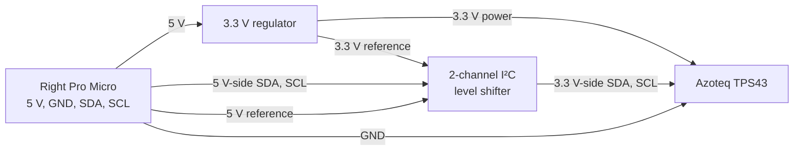

# Sofle RGB + TPS43 trackpad: wiring and firmware plan

## Hardware choice

Use an **Azoteq TPS43 (43 × 40 mm, I²C)** on the **right** side. The official QMK `azoteq_iqs5xx` driver supports it. The existing two **Pro Micro ATmega32U4** controllers stay in place during the wired prototype.

**Confirm the controller voltage first.** ATmega32U4 Pro Micro boards exist in **5 V/16 MHz** and **3.3 V/8 MHz** versions. The circuit below handles the **5 V version**. If both the controller and I²C bus operate at verified 3.3 V, a direct 3.3 V I²C connection may be possible. Do not feed a 3.3 V controller into a 5 V-input regulator without checking its dropout specification.

> **Do not connect the TPS43 to 5 V or connect I²C directly at 5 V.** The trackpad supply range is **1.65–3.6 V**. A 5 V Pro Micro needs a voltage regulator and a bidirectional I²C level shifter unless a verified adapter already includes both.

## Wiring diagram



**Right Pro Micro connection points, 5 V controller variant:**

| Origin | Connection | Destination |
|---|---|---|
| Pro Micro `VCC` (5 V board only) | 5 V supply | 3.3 V regulator `VIN`, shifter `HV` |
| Pro Micro `GND` | Common ground | Regulator `GND`, shifter `GND`, TPS43 `GND` |
| Regulator `3V3` | 3.3 V supply | Shifter `LV`, TPS43 `VDDHI` |
| Pro Micro `SDA` (`D1` in QMK / Arduino pin 2) | High-voltage I²C | Shifter `HV1` |
| Pro Micro `SCL` (`D0` in QMK / Arduino pin 3) | High-voltage I²C | Shifter `HV2` |
| Shifter `LV1` | Low-voltage I²C | TPS43 `SDA` |
| Shifter `LV2` | Low-voltage I²C | TPS43 `SCL` |

**TPS43 6-way FFC contacts, per Azoteq's TPS43 datasheet:**

| FFC pin | Signal | Prototype connection |
|---|---|---|
| 1 | `RDY` | Break out and insulate; check driver/adapter requirements |
| 2 | `NRST` | Break out and insulate; check reset pull-up requirement |
| 3 | `GND` | Common ground |
| 4 | `VDDHI` | 3.3 V regulated supply |
| 5 | `SCL` | Shifter LV SCL |
| 6 | `SDA` | Shifter LV SDA |

The pin numbers refer to the **contact numbering in the manufacturer's drawing**. The apparent left-to-right order changes when the FFC connector is flipped. Verify the breakout PCB silkscreen and connector contact orientation before applying power.

### What to purchase

1. Azoteq **TPS43** touchpad, preferably with a finished overlay. A bare `-A` variant needs an added protective touch surface.
2. Correct **0.5 mm-pitch, 6-contact FFC breakout** and compatible FFC cable. Confirm top/bottom-contact orientation against the module.
3. **3.3 V low-dropout regulator**, rated for a 5 V input and the full trackpad load.
4. **2-channel bidirectional I²C level-shifter module** (for example, BSS138-type). Confirm both voltage reference pins and pull-ups.
5. Small insulated hookup wire, heat-shrink, mounting tape, up to **14 M2 inserts and screws**, and a short internal TRRS cable.

Use the right OLED's 4-pin I²C header only after you verify its **exact pin order and operating voltage**. The Sofle RGB has different board and fork revisions. The header may already carry I²C or share it with the OLED. Remove the right OLED for the initial firmware test to reduce load and firmware size. Do not assume every 4-pin header uses the same order.

### Electrical test before connecting the trackpad

1. Disconnect USB and all battery sources.
2. Check the Pro Micro label and measure its `VCC` with USB connected. Decide whether to use the 5 V circuit or the separate 3.3 V circuit.
3. Disconnect USB again.
4. Wire the 3.3 V regulator and level shifter without the TPS43 attached.
5. Connect USB and measure the regulator output and both shifter-side idle levels. Both trackpad-side I²C lines must stay at or below 3.3 V.
6. Disconnect USB. Attach the TPS43 FFC, with pin 1 verified.
7. Connect USB again. Confirm QMK can detect and read the trackpad.

Never insert or remove the internal TRRS connector while either Pro Micro has power.

## QMK firmware starting point

The official QMK pointing device driver supports IQS572/TPS43. The following settings are **configuration fragments**, not firmware ready to flash on an unknown Sofle RGB revision.

`keyboards/sofle/keymaps/<your-keymap>/rules.mk`:

```make
POINTING_DEVICE_ENABLE = yes
POINTING_DEVICE_DRIVER = azoteq_iqs5xx

# Reduce ATmega32U4 flash use if the build exceeds memory.
# OLED_ENABLE = no
# RGBLIGHT_ENABLE = no
```

`keyboards/sofle/keymaps/<your-keymap>/config.h`:

```c
#pragma once

#define AZOTEQ_IQS5XX_TPS43

// Required only if using the split-pointing transport path:
// #define SPLIT_POINTING_ENABLE
// #define POINTING_DEVICE_RIGHT

// Right half receives USB during the first hardware test.
// If the keyboard uses the MASTER_RIGHT handedness strategy:
// #define MASTER_RIGHT
```

**Important:** Choose the split-pointing method that matches your QMK revision. QMK uses `SPLIT_POINTING_ENABLE` for devices on one side. Handedness configuration depends on the Sofle board build. Do not add both `EE_HANDS` and `MASTER_RIGHT` without checking the existing firmware. If you use `SPLIT_POINTING_ENABLE`, configure `POINTING_DEVICE_RIGHT` and a valid handedness mechanism.

**ATmega32U4 limit:** Its flash memory is tight with RGB effects, OLED, VIA, and trackpad support. Run a clean QMK compile and inspect the reported firmware size. Disable OLED and optional RGB effects before removing required key or pointing functions.

## First validation sequence

1. Test each Sofle half with its current QMK firmware.
2. Connect both halves through the internal TRRS cable while all power is off.
3. Test the TPS43 with the right Pro Micro before installing it in the case.
4. Verify pointer movement, single-finger click, two-finger right-click, and two-finger scroll.
5. Fit the case coupon and confirm module dimensions, cable bend radius, and overlay height.
6. Print the full case only after the physical outline and hole pattern match your PCB.

## Wireless is a separate phase

The existing ATmega32U4 Pro Micros do **not** support Bluetooth. A wireless couch version needs a controller replacement and battery design. An nRF52840 controller pair with ZMK is a possible route, but the RGB power budget and TPS43 integration need a separate review.

## Sources

- Official Sofle RGB design: https://github.com/josefadamcik/SofleKeyboard
- Official QMK pointing device guide: https://docs.qmk.fm/features/pointing_device
- Azoteq trackpad hardware datasheet: https://www.azoteq.com/images/stories/pdf/proxsense_i2c_trackpad_datasheet.pdf
- Related ZMK Sofle + TPS43 project: https://github.com/suchobits/zmk-config-sofle-trackpad
