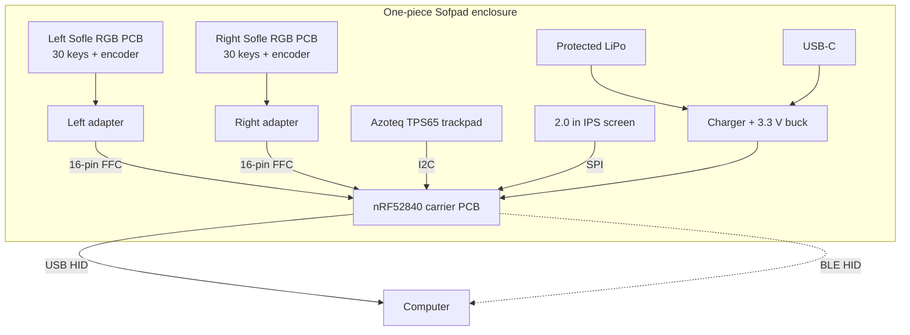

# Sofpad

**A wireless, split-layout mechanical keyboard in one piece: two Sofle RGB boards in an Alice-style tilted case, with a trackpad between the thumbs, one screen and one battery.**


## What it is

Sofpad is a keyboard for the sofa and the desk. Two original [Sofle RGB](https://github.com/josefadamcik/SofleKeyboard) PCBs sit in a single printed shell, each tilted 12° like an Alice keyboard, so your hands rest naturally and the keyboard stays one object you can carry and lay on your lap. Between the thumb clusters sits a large trackpad that either thumb reaches, so the mouse never needs a separate hand movement.

One controller scans both halves. It talks to the computer over **USB-C cable or Bluetooth**, your choice at any time. The case is designed to look at home in a living room, and to be clean and serviceable on the inside: everything except the key boards rides on one removable plate.

## Features

| | |
|---|---|
| **Layout** | Sofle RGB, 30 keys per half, tilted 12° per half in an Alice-style plan, flat vertically |
| **Switches** | Cherry MX style, hot-swap |
| **Pointing** | Azoteq TPS65 trackpad, 65 × 49 mm, centre front between the thumbs |
| **Controls** | Two rotary encoders |
| **Screen** | One 2.0 in IPS display (centre rear) replaces the two small OLEDs |
| **Connectivity** | USB-C HID and Bluetooth LE HID, both always available |
| **Feel** | Haptic feedback on the trackpad (DRV2605L + LRA) |
| **Power** | One protected 1100 mAh LiPo, USB-C charging, power switch, wake on lift (LIS3DH) |
| **Controller** | One nRF52840 carrier board; the two original Pro Micro boards are removed |
| **Case** | 383 × 153 × 17.1 mm printed shell, one set of screws opens it, no paint |
| **Software** | ZMK firmware. No PC app is ever required |

## Status

Hardware design is complete and being finished for ordering. Nothing is built or tested yet.

| Area | State |
|---|---|
| Case CAD | Done. Automated checks pass: no part overlaps, everything fits its cavity, shell and plate are single solids, meshes are closed |
| Schematics | Carrier and both adapters generated, ERC clean |
| PCB layout | Carrier and both adapters routed. DRC: 0 errors, 0 unconnected |
| Verification without hardware | Schematic, layout and generator netlists agree. Every key, encoder and ground path traced from the Sofle PCB to the nRF52840 GPIO. Power, divider and bus values checked against datasheet formulas. See [ARCHITECTURE.md](hardware/r3/ARCHITECTURE.md) |
| Bill of materials | Done, India sourcing, about ₹5,156 in parts (some prices are estimates) |
| Fabrication | Fab files exported for the carrier and both adapters (`hardware/r3/pcb/fab`). Quotes and orders not placed |
| Firmware | Not started (ZMK) |
| Bench test | Months away, after hardware is ordered and built |

This is a development project, not a tested product.

## Gallery


Keycaps, knobs, battery, carrier and trackpad are fit-check envelopes. The shell, PCB outlines, key positions and mount holes are real geometry. Renders are in [docs/images](docs/images/).

## How it works



Each Sofle half keeps its keys, diodes and encoder. A small adapter solders into the old Pro Micro position and brings the matrix out on a 16-way flat cable to the single carrier board, which holds the MCU, charger, regulator, haptics driver, accelerometer and the screen and trackpad connectors. Power follows the sleep design in [ARCHITECTURE.md](hardware/r3/ARCHITECTURE.md): idle current of a few microamps, wake on key press or lift.

## Repository guide

| You want | Go to |
|---|---|
| Engineering specification | [hardware/r3/ARCHITECTURE.md](hardware/r3/ARCHITECTURE.md) |
| Parts and prices | [BOM.md](hardware/r3/BOM.md) · [BOM.csv](hardware/r3/BOM.csv) |
| PCB sources and fab export | [hardware/r3/pcb](hardware/r3/pcb/) (`carrier.py`, `adapter.py`, `build_pcb.py`, `fab_export.py`) |
| Case CAD and checks | [cad/r3](cad/r3/): [Sofpad_R3_Alice.scad](cad/r3/Sofpad_R3_Alice.scad), `check_design.py`, [DESIGN_RULES.md](cad/r3/DESIGN_RULES.md) |
| Renders | [docs/images](docs/images/) |
| Earlier concepts | [R1](cad/r1/), [R2](cad/r2/), [original source package](archives/Sofpad_All_Source_Files.zip) |

### Build it

Tools: OpenSCAD nightly (Manifold backend), KiCad 10, Freerouting 2.5 with Java 25, Blender 5.

```text
python cad/r3/check_design.py                  case checks, must print PASS
python hardware/r3/pcb/erc.py carrier          schematic check
python hardware/r3/pcb/build_pcb.py carrier    place and route (KiCad's Python)
python hardware/r3/pcb/drc.py carrier carrier  design rule check
python hardware/r3/pcb/fab_export.py carrier carrier   Gerbers, drill, placement, BOM, zip
```

Order settings (layers, mask, finish, assembly) are in the Manufacturing section of [ARCHITECTURE.md](hardware/r3/ARCHITECTURE.md). The case prints in one piece on a large FDM printer, unpainted.

## Remaining work

1. Collect quotes (JLCPCB and Indian fabs) from the exported fab files, then order boards and case.
2. Print a small fit-test piece, then the full shell.
3. Confirm the trackpad flex pitch when the part arrives (both breakout boards are on the BOM).
4. Firmware: ZMK board definition, matrix, encoders, USB and Bluetooth, trackpad gestures, haptics, wake on lift, screen.
5. Deferred: hinged tenting lift, host data on the screen over Bluetooth, over-the-air updates, optional PC companion app.

## History and source integrity

R1 (couch case) and R2 (TPS43 unibody) are kept as earlier concepts. The original ZIP is the authoritative source package: a manual file upload once flattened its folders and left 14 zero-byte files, so use the archive when you need an exact original.

## License

The Sofle RGB PCB is licensed by its author, see [LICENSE-SOFLE.txt](LICENSE-SOFLE.txt). Project license: [LICENSE](LICENSE).
