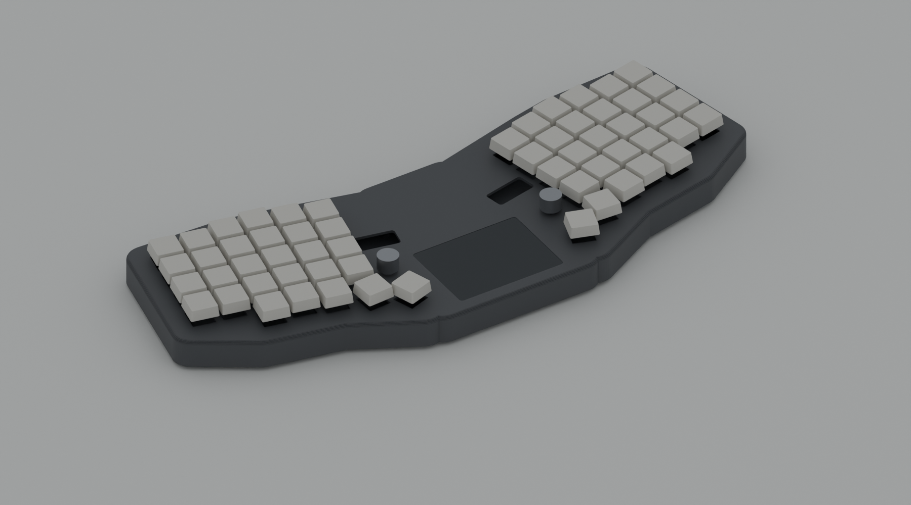
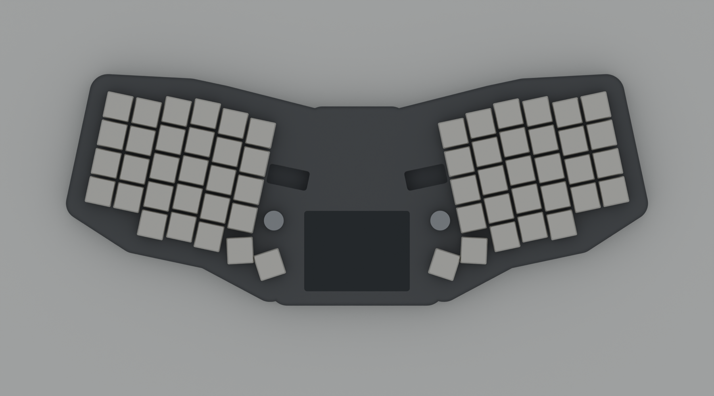
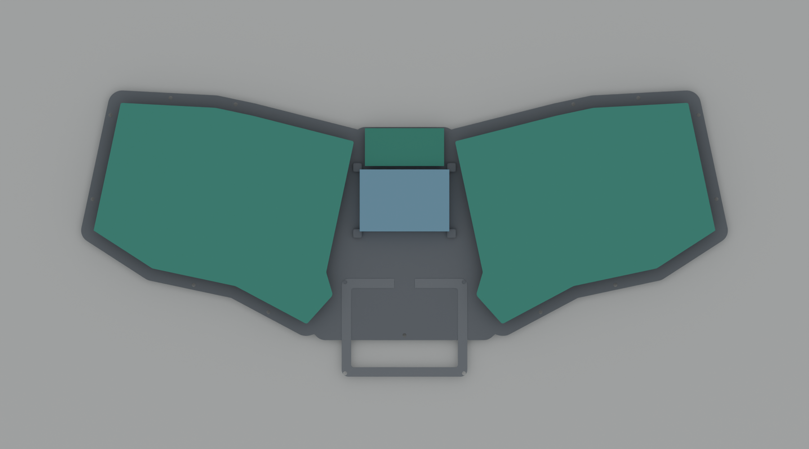
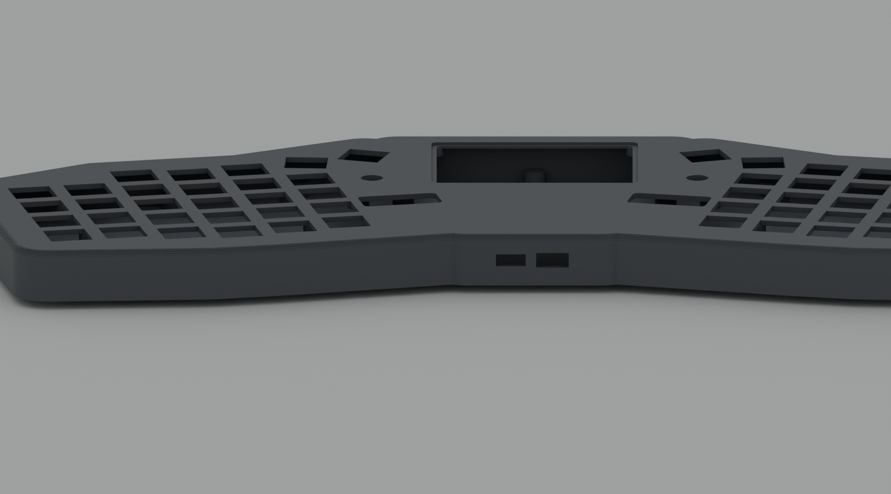
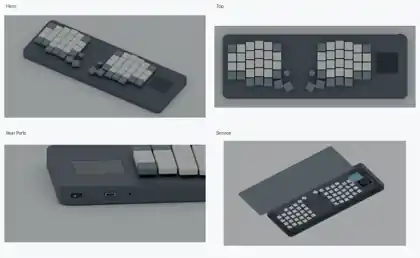
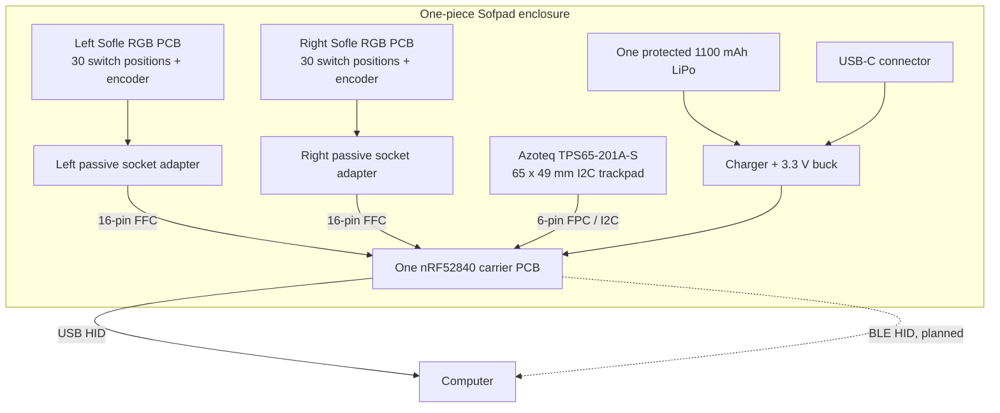
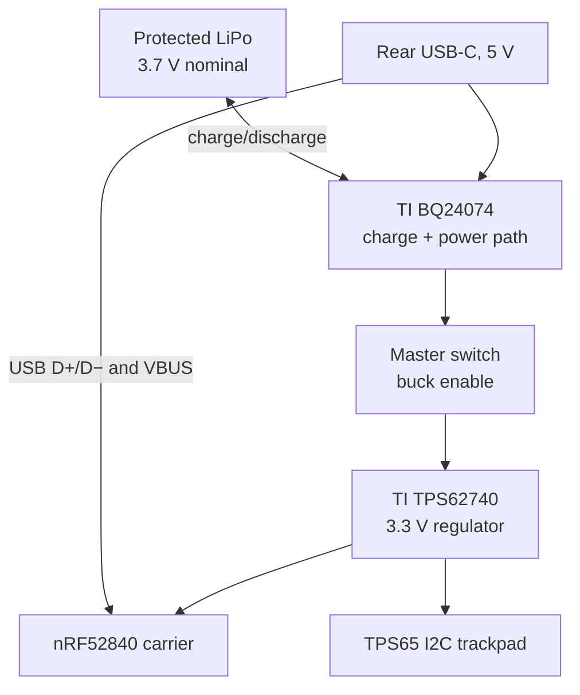

# Sofpad

**A compact, one-piece ergonomic keyboard based on Sofle RGB, with a built-in trackpad, one controller, and one battery.**

The current **R3 concept** puts two original Sofle RGB PCB halves in one printed unibody, tilted 12° in an Alice-style plan. One nRF52840 controller scans both halves. A large **Azoteq TPS65 trackpad sits in the centre between the thumb clusters**, so either thumb reaches it. One LiPo powers the device. The planned interface is wired USB HID and wireless BLE HID.

> **Engineering status:** Source-verified architecture and preliminary CAD. This project is **not** a production-ready PCB, tested firmware, or validated LiPo charging design. The repository includes R1 and R2 historical concepts and R3 source files.

## Render gallery

All renders come from the CAD in [cad/r3](cad/r3/), built by `render_case.py` from the exported STLs.
They are in [docs/images](docs/images/).

### R3 — current Alice-style case with centre trackpad









*Keycaps, knobs, battery, carrier and trackpad are fit-check envelopes. The shell, PCB outlines, key positions and mount holes are real geometry.*

### R2 — earlier TPS43 unibody concept



## Quick links

| Resource | Location |
|---|---|
| **Complete original source package** | [Sofpad_All_Source_Files.zip](archives/Sofpad_All_Source_Files.zip) |
| **R3 engineering specification** | [Architecture and electrical design](hardware/r3/ARCHITECTURE.md) |
| **R3 bill of materials** | [BOM.md](hardware/r3/BOM.md) · [BOM.csv](hardware/r3/BOM.csv) |
| **R3 CAD source** | [Sofpad_R3_Alice.scad](cad/r3/Sofpad_R3_Alice.scad) · checks: [check_design.py](cad/r3/check_design.py) |
| **R3 original notes** | [README.md](hardware/r3/README.md) |
| **Reference PCB** | [SofleKeyboard.kicad_pcb](hardware/r3/reference/Sofle_RGB/PCB/SofleKeyboard.kicad_pcb) |
| **Earlier R1 / R2 concepts** | [R1](cad/r1/) · [R2](cad/r2/) |
| **Renders** | [docs/images](docs/images/) |
| **Upstream license** | [LICENSE-SOFLE.txt](LICENSE-SOFLE.txt) |

## Design goals

- One nRF52840 microcontroller for all keyboard inputs, both encoders, and the touchpad.
- One internal wired connection to each Sofle RGB PCB, using passive Pro Micro socket adapters.
- Alice-style 12° tilt per half and a centre trackpad between the thumb clusters.
- Both OLED windows and both rotary encoders stay in use.
- One protected LiPo battery and one rear USB-C port for charging and USB HID.
- USB keyboard and mouse HID plus BLE keyboard and mouse HID in the planned firmware.
- A continuous upper shell, removable service cover, and trackpad retainer.
- Existing RGB LEDs and OLED displays disconnected for the first low-power revision.

## Hardware architecture



Neither keyboard half needs a separate MCU. The two original ATmega32U4 Pro Micro boards are removed. Passive adapters connect existing key and encoder signals to the single nRF52840 carrier.

### Keyboard matrix and controller allocation

The source Sofle RGB PCB has **30 diode-protected switch positions per half**. The two halves share **five row inputs** and use **six columns per half**.

| Interface | Signals | Preliminary nRF52840 GPIO |
|---|---:|---|
| Shared rows | 5 | P0.13–P0.17 |
| Right columns | 6 | P0.19–P0.24 |
| Left columns | 6 | P0.25–P0.27, P1.00–P1.02 |
| Left encoder A/B | 2 | P1.03–P1.04 |
| Right encoder A/B | 2 | P1.05–P1.06 |
| Trackpad I2C SDA/SCL/RDY/NRST | 4 | P0.04–P0.07 |
| Battery ADC | 1 | P0.02 |
| USB and SWD | Dedicated | Module USB and debug pins |

Each passive keyboard adapter uses a **16-way FFC**. Pins 1–5 carry rows, 6–11 carry columns, 12–13 carry encoder signals, and 14 carries ground. Pins 15–16 remain unused. Check actual connector orientation before manufacturing.

The detailed signal mapping, original Pro Micro pad references, and Raytac module pad numbers are in [ARCHITECTURE.md](hardware/r3/ARCHITECTURE.md).

### Trackpad

The current revision uses the **Azoteq TPS65-201A-S**: 65 × 49 mm, IQS550, I2C at 400 kHz, address 0x74, 6-pin FPC (RDY, NRST, GND, VDDHI, SCL, SDA). It shares its pinout and the ZMK driver with the TPS43. The pad sits in the centre of the case because both thumbs can reach it and the space between the tilted halves would otherwise be empty. The earlier Cirque SPI trackpad is retired.

## Charging and power



The R3 concept uses a protected **NOVA 603450, 1100 mAh** LiPo. The rear master switch controls regulator enable, not the battery-positive lead. The charger can remain connected to the battery while the keyboard is off.

**Do not construct the battery circuit from this overview.** Charging current, thermistor network, USB limits, cell dimensions, protection, and regulator values are not final. See the design gates in [ARCHITECTURE.md](hardware/r3/ARCHITECTURE.md).

## Mechanical concept

The one-piece upper shell is **383 × 153 × 17.5 mm**. The two Sofle halves are tilted 12° toward the user. The trackpad fills the front centre. The battery lies behind it, and the carrier PCB sits against the rear wall with USB-C and the power switch. Everything except the PCB halves rides on the removable service plate, so one set of screws opens the case.

| Revision | Purpose | Important distinction |
|---|---|---|
| **R1** | Initial couch-style case and wiring study | Azoteq TPS43 |
| **R2** | Intermediate one-piece shell, service cover, retainer | Azoteq TPS43 |
| **R3** | Current Alice-style case, single controller | Azoteq TPS65 centre pad + nRF52840 |

Open the [R3 OpenSCAD design](cad/r3/Sofpad_R3_Alice.scad) to edit the case, and run `python cad/r3/check_design.py` after every change. The checks prove part clearances, cavity fit, single-piece shell and plate, and closed meshes. The CAD is preliminary and needs real component measurements.

## Repository structure

```text
Sofpad/
├── README.md
├── LICENSE-SOFLE.txt
├── docs/images/                       All renders (R3 PNGs, R2 gallery)
├── archives/
│   └── Sofpad_All_Source_Files.zip     Exact original complete source package
├── hardware/
│   └── r3/
│       ├── README.md                   Original R3 engineering overview
│       ├── ARCHITECTURE.md
│       ├── BOM.md
│       ├── BOM.csv
│       ├── source_pinmap.json
│       ├── verify_matrix.py
│       └── reference/Sofle_RGB/PCB/SofleKeyboard.kicad_pcb
├── cad/
│   ├── r1/                             Original couch case and fit coupon
│   ├── r2/                             Intermediate unibody
│   └── r3/                             Current Alice-style case, checks, render script
└── docs/
    └── legacy/
        └── QMK_and_wiring.md          Historical two-controller wiring concept
```

### Source-file integrity

**The original ZIP is the authoritative source package.** The manual individual-file upload flattened version directories and overwrote some same-named files. Several files uploaded as **zero-byte blobs**, including shared geometry, renders, and some STL exports. An audit of the original 49 archive files found **21 exact individual-file matches, 14 empty files, 10 missing files, and 3 license-file differences**, plus the separate root layout PNG included in the archive. The original archive still contains the full source. The new render galleries do not replace full-resolution original PNG files. These empty files remain visible in the organized folders, but they cannot be used as valid CAD data. Extract the original archive for the exact working source of each revision.

The original root README was also uploaded as an empty file. This README replaces it with project documentation.

## Component summary

| Part | Selected model |
|---|---|
| Wireless MCU | Raytac MDBT50Q-1MV2, Nordic nRF52840 |
| Trackpad | Azoteq TPS65-201A-S, 65 x 49 mm I2C |
| Power-path charger | TI BQ24074RGTR |
| 3.3 V regulator | TI TPS62740DSST |
| LiPo | NOVA 603450 protected 1100 mAh |
| USB-C | GCT USB4085-GF-A |
| Power switch | E-Switch EG1213 |
| Internal connections | 16-pin FFC cables and passive Pro Micro socket adapters |

The R3 BOM lists reference part prices, not a final build cost. Custom PCBs, assembly, printing, shipping, and unselected components need separate costing.

## Remaining engineering work

1. Measure the physical keyboard PCBs, trackpad, cell, connectors, and switch.
2. Finalize passive socket adapters and FFC contact orientation.
3. Design the nRF52840 carrier, charger, regulator, USB-C and RF antenna area.
4. Build and check a small mechanical fit sample before the full print.
5. Implement keyboard scanning, encoders, TPS65 I2C, USB HID, BLE HID, and power management.
6. Validate safe charging, wake/sleep operation, all inputs, wireless stability, and case fit.

**R3 is a development project, not a tested finished product.**

## Attribution

The PCB and derived case geometry use the [SofleKeyboard](https://github.com/josefadamcik/SofleKeyboard) project by Josef Adamcik. Source PCB commit: `fb294f7c58d0f91c379a9ef339159d4d056643e9`. Preserve the included upstream license notices for Sofle, Lily58, Helix, crkbd, and Ergo42. A separate license for new Sofpad-specific work has not been selected.
