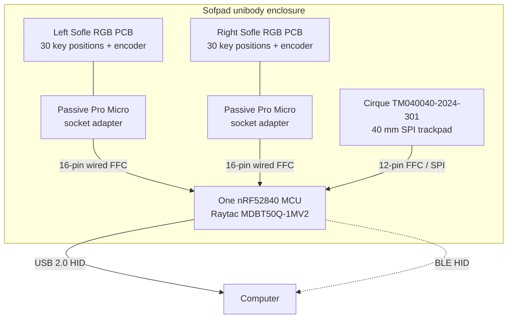
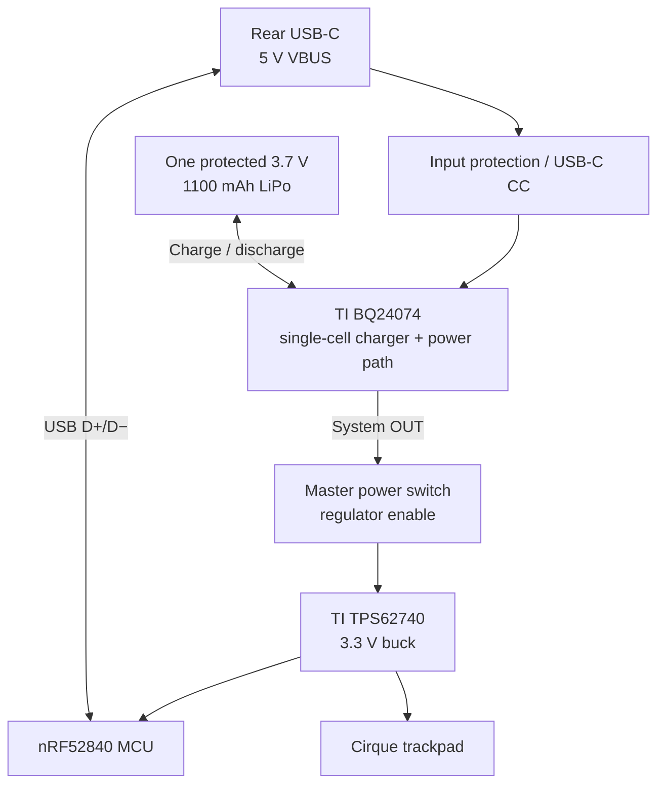

# Sofpad

**A one-piece, split-layout ergonomic keyboard with an integrated trackpad, one controller, and one battery.**

Sofpad combines two Sofle RGB keyboard PCB halves inside a slim unibody enclosure. A single **Nordic nRF52840** controller reads both halves over internal wired connections and operates a **40 mm Cirque SPI trackpad**. One protected LiPo battery powers the device. One USB-C port provides charging and wired USB HID. Bluetooth Low Energy (BLE) HID is planned for wireless operation.

> **Project state — 9 November 2026:** R3 is a source-verified architecture and preliminary CAD design, **not** a fabricated, assembled, or firmware-tested keyboard. The complete source package was uploaded as `Sofpad_All_Source_Files.zip` according to the repository owner. The archive is the source-package distribution; the repository also contains selected individual files.

## Source archive

**[Sofpad_All_Source_Files.zip](./Sofpad_All_Source_Files.zip)** contains the complete project source package, including all three design revisions, KiCad PCB reference, OpenSCAD source, STL exports, renders, wiring notes, and bills of materials. Extract the archive to work with individual files. The archive's exact GitHub path has not been independently confirmed through the connector.

## Design principles

- **One controller:** one nRF52840 manages both key matrices, two rotary encoders, and the trackpad.
- **One battery:** one protected 3.7 V LiPo supplies the entire keyboard.
- **Hardwired halves:** two internal FFC cables replace the Bluetooth link and the original inter-half communication path.
- **Single body:** both Sofle RGB halves and the trackpad share a continuous printed case with a removable service cover.
- **USB + BLE:** wired USB HID when connected; wireless BLE HID when unplugged. Both require custom firmware.
- **Preserve the source PCBs:** use passive adapters in the existing Pro Micro footprints instead of cutting traces.
- **Low-power first revision:** leave the existing RGB LEDs and OLEDs electrically disconnected.

## Product layout

The current case concept is approximately **390 × 136 mm** in plan view. It holds two Sofle RGB PCBs, a right-side round trackpad, the controller carrier, battery, and rear-facing USB-C and power switch.

```text
                          REAR EDGE
        ┌─────────────────────────────────────────────────┐
        │              USB-C   POWER SWITCH               │
        │                                                 │
        │   LEFT SOFLE PCB         RIGHT SOFLE PCB         │
        │   ┌─────────────┐        ┌─────────────┐        │
        │   │ keys + knob │        │ keys + knob │        │
        │   │ 30 positions│        │ 30 positions│        │
        │   └──────┬──────┘        └──────┬──────┘        │
        │          │                      │    ○           │
        │       FFC cable             FFC cable  Cirque   │
        │          │                      │    40 mm       │
        │          └────────┬─────────────┘                │
        │                   │                              │
        │          nRF52840 carrier                        │
        │          charger + regulator                     │
        │          single LiPo battery                     │
        └─────────────────────────────────────────────────┘
                          FRONT EDGE
```

*Concept diagram only; component placement and mechanical clearances are not final.*

## System architecture



There are **no independent controllers on the left and right keyboard halves**. Both original ATmega32U4 Pro Micro boards are removed. Each half connects through a passive adapter to the same nRF52840 carrier.

### Source PCB and key matrix

The design uses Josef Adamcik's Sofle RGB PCB at upstream commit `fb294f7c58d0f91c379a9ef339159d4d056643e9`. The source KiCad footprint/net analysis identifies **30 diode-protected switch positions per half**, including each encoder's push switch. That gives **60 switch positions** and **two rotary encoder pairs**.

The two halves share **five row inputs**. Each half has its own **six column outputs**. The combined keyboard therefore needs five row inputs, twelve column outputs, and four encoder inputs. The firmware must follow the source PCB's diode direction and must not drive the legacy TRRS link.

| Signal group | Count | Electrical behavior |
|---|---:|---|
| Shared rows | 5 | MCU inputs |
| Left columns | 6 | MCU outputs |
| Right columns | 6 | MCU outputs |
| Left encoder | 2 | MCU inputs |
| Right encoder | 2 | MCU inputs |
| Trackpad | 5 | SPI SCK, MISO, MOSI, CS, data-ready |
| Battery sense | 1 | ADC input |
| USB | Dedicated | D+/D− and VBUS |
| Debug | Dedicated | SWDIO/SWDCLK |

### Passive adapter and FFC pinout

Each Pro Micro socket adapter routes fourteen active signals through a sixteen-position FFC connector.

| FFC pins | Original U1 pads | Signals |
|---|---|---|
| 1–5 | 8–12 | `row0`–`row4` |
| 6–10 | 18–14 | `col0`–`col4` |
| 11 | 13 | `SW25A`, sixth column |
| 12–13 | 20, 19 | `ENCA`, `ENCB` |
| 14 | 23 | GND |
| 15–16 | — | Not connected |

The two FFC cable lengths are preliminary: **203 mm left** and **50 mm right**. Cable orientation, pin 1, and contact side require physical confirmation.

### Preliminary nRF52840 GPIO plan

| Function | GPIO |
|---|---|
| Shared rows 0–4 | P0.13–P0.17 |
| Right columns 0–5 | P0.19–P0.24 |
| Left columns 0–5 | P0.25–P0.27, P1.00–P1.02 |
| Left encoder A/B | P1.03, P1.04 |
| Right encoder A/B | P1.05, P1.06 |
| Trackpad SCK/MISO/MOSI/CS/DR | P0.04–P0.08 |
| Battery ADC | P0.02 / AIN0 |
| Reset | P0.18 / nRESET |
| USB, SWD | Dedicated module pins |

This pin plan is preliminary. The Raytac module has drive-speed and RF antenna-layout restrictions. See the full `ARCHITECTURE.md` in the R3 source package.

## Trackpad

The selected sensor is **Cirque TM040040-2024-301**, a 40 mm round **SPI** trackpad. The `2024` variant is SPI; the similar `2023` variant is I²C. The trackpad uses a twelve-position 0.5 mm FFC connector.

| Cirque pin | Function | nRF GPIO |
|---:|---|---|
| 1 | SCK | P0.04 |
| 2 | MISO | P0.05 |
| 3 | Chip select (SS) | P0.07 |
| 4 | Data ready (DR) | P0.08 |
| 5 | MOSI | P0.06 |
| 6–10 | Optional buttons / I²C | Not used in R3 |
| 11 | GND | Common ground |
| 12 | VDD | Regulated 3.3 V |

The mechanical model includes a dedicated sensor recess and a removable retainer. The sensor's real thickness, notch geometry, connector orientation, and surface height still need a physical fit check.

## One-battery power architecture



The planned cell is a protected **NOVA 603450, 1100 mAh** LiPo. The power design uses a BQ24074 power-path charger and a TPS62740 3.3 V regulator. The USB-C connector handles both USB data and charging. The master switch controls the regulator enable.

**Battery safety:** The charging-current resistors, thermal sensing, cell dimensions, connector polarity, and complete protection circuit are not yet validated. Do not assemble or charge the circuit from this diagram alone.

## Preliminary bill of materials

The figures below come from the R3 parts research on 9 November 2026. They are reference prices, not live quotes.

| Component | Selected part | Qty | Reference price |
|---|---|---:|---:|
| BLE / USB MCU | Raytac MDBT50Q-1MV2 / Seeed 113990582 | 1 | ₹1,141.32 |
| 40 mm SPI trackpad | Cirque TM040040-2024-301 | 1 | ₹920.05 |
| Charger / power path | TI BQ24074RGTR | 1 | ₹232.19 |
| 3.3 V buck regulator | TI TPS62740DSST | 1 | ₹189.19 |
| Protected 1100 mAh LiPo | NOVA 603450 | 1 | ₹239.00 |
| USB-C receptacle | GCT USB4085-GF-A | 1 | ₹86.95 |
| Slide switch | E-Switch EG1213 | 1 | ₹72.28 |

**Core parts subtotal: ₹2,880.98.** The R3 BOM lists a broader tracked subtotal of **₹4,086.25** including selected connectors and other parts. These figures exclude custom PCB fabrication, assembly, 3D printing, missing passives, shipping, and taxes. The final cost is not established.

Additional parts include four Molex 16-pin FFC sockets, two keyboard FFC cables, a Cirque FFC socket/cable, a JST-PH battery connector, USB ESD protection, an NTC thermistor, and the custom carrier and adapter PCBs. See `sofle_single_controller/BOM.csv` and the source package's `BOM.md`.

## Mechanical design and ports

The current R3 case design uses:

- A continuous upper unibody shell for both Sofle halves.
- A removable bottom service cover for the battery and controller.
- A dedicated 40 mm trackpad retainer.
- M2 mounting points and source-derived key/switch positions.
- Rear cutouts for USB-C and the power switch.
- OpenSCAD source so dimensions can change without rebuilding a mesh manually.

The **390 × 136 mm** upper shell needs a large-format printer or an appropriate printing service. Exported STL files are preliminary models, not verified production parts.

## Firmware plan

The planned firmware is a **single nRF52840 image**, not two synchronized keyboard firmwares. It must:

1. Scan five shared rows and twelve independent columns with the correct diode direction.
2. Decode both rotary encoders and their push switches.
3. Read Cirque SPI movement and gestures.
4. Expose USB keyboard/mouse HID while wired.
5. Expose BLE keyboard/mouse HID while wireless.
6. Report battery state and manage low-power sleep/wake.
7. Handle USB connection and BLE reconnection without duplicate inputs.

**No working firmware implementation is included in the current R3 source package.** The items above are implementation requirements, not completed features.

## Project revisions and source files

| Revision / folder | Purpose |
|---|---|
| `sofle_couch/` | Initial Sofle RGB couch-case CAD, wiring notes, layout image, and fit coupon |
| `sofle_unibody_v2/` | Updated unibody shell, service cover, trackpad retainer, and rendered views |
| `sofle_single_controller/` | R3 single-nRF52840 architecture, BOM, KiCad reference, pin mapping, and updated CAD |

The original Library source package also includes:

```text
sofle_couch/
  README.md
  QMK_and_wiring.md
  SofleRGB_Couch_Case.scad
  SofleRGB_Couch_Case.stl
  TPS43_Fit_Coupon.stl
  CAD_layout.png / CAD_layout.svg
  extract_sofle_geometry.py
  render_layout.py
  validate_stl.py

sofle_unibody_v2/
  README.md
  SofleRGB_Unibody_Couch.scad
  Unibody_Shell.stl
  Service_Bottom.stl
  TPS43_Retainer.stl
  render_hero.png
  render_top.png
  render_rear_ports.png
  render_service.png

sofle_single_controller/
  README.md
  ARCHITECTURE.md
  BOM.md
  BOM.csv
  verify_matrix.py
  source_pinmap.json
  cad/
    SofleRGB_SingleController_Cirque.scad
    Unibody_Shell.stl
    Service_Bottom.stl
    Cirque40_Retainer.stl
    render_hero.png
    render_top.png
    render_rear_ports.png
    render_service.png
  reference/Sofle_RGB/PCB/SofleKeyboard.kicad_pcb
```

**Repository layout:** The paths above describe the contents of the source archive. They are not necessarily separate files in the repository root. Download and extract `Sofpad_All_Source_Files.zip` to access the full folder structure.

## Engineering status

| Area | Status | Next requirement |
|---|---|---|
| Original Sofle PCB net mapping | Source-verified | Confirm physical left/right socket orientation |
| Single-controller pin budget | Preliminary allocation | Complete carrier schematic and RF layout |
| Wired FFC architecture | Defined | Confirm pin-1 orientation and cable routing |
| Cirque SPI interface | Selected and mapped | Test actual sensor and mechanical fit |
| Battery and charger | Components selected | Design and validate safe charge/power circuitry |
| Case CAD | Preliminary SCAD and STL exports | Print and measure fit samples |
| USB-C port and switch | Concept cutouts | Check real component alignment |
| Firmware | Requirements defined | Implement and test |
| Source archive | Uploaded by repository owner; GitHub path not independently confirmed | Confirm the archive link resolves |

## Build sequence

1. Measure the original PCBs, chosen trackpad, cell, USB-C connector, and switch.
2. Finalize the passive adapter footprints and FFC orientation.
3. Complete the carrier PCB schematic, charging design, and RF layout.
4. Print and check a small port/trackpad fit sample.
5. Adjust and print the complete shell and bottom cover.
6. Assemble the carrier and adapters with safe battery handling.
7. Implement USB/BLE HID and key/encoder/trackpad firmware.
8. Validate charging, current draw, sleep, wireless behavior, and input accuracy.

This is a development sequence, **not a claim that the steps are complete**.

## References and attribution

- [SofleKeyboard by Josef Adamcik](https://github.com/josefadamcik/SofleKeyboard) — source keyboard PCB and geometry.
- [Cirque TM040040-2024-301](https://www.mouser.in/en/ProductDetail/Cirque/TM040040-2024-301) — selected SPI trackpad.
- [Raytac/Seeed nRF52840 module](https://www.digikey.in/en/products/detail/seeed-technology-co-ltd/113990582/9697025).
- [TI BQ24074](https://www.digikey.in/en/products/detail/texas-instruments/BQ24074RGTR/5142985) and [TI TPS62740](https://www.digikey.in/en/products/detail/texas-instruments/TPS62740DSST/4503015).
- Preserve the upstream Sofle/Lily58/Helix/crkbd/Ergo42 license notices supplied in `LICENSE-SOFLE.txt`.

**License note:** Upstream PCB and derived geometry retain their original attribution. A separate license for new Sofpad-specific design work has not been established.
