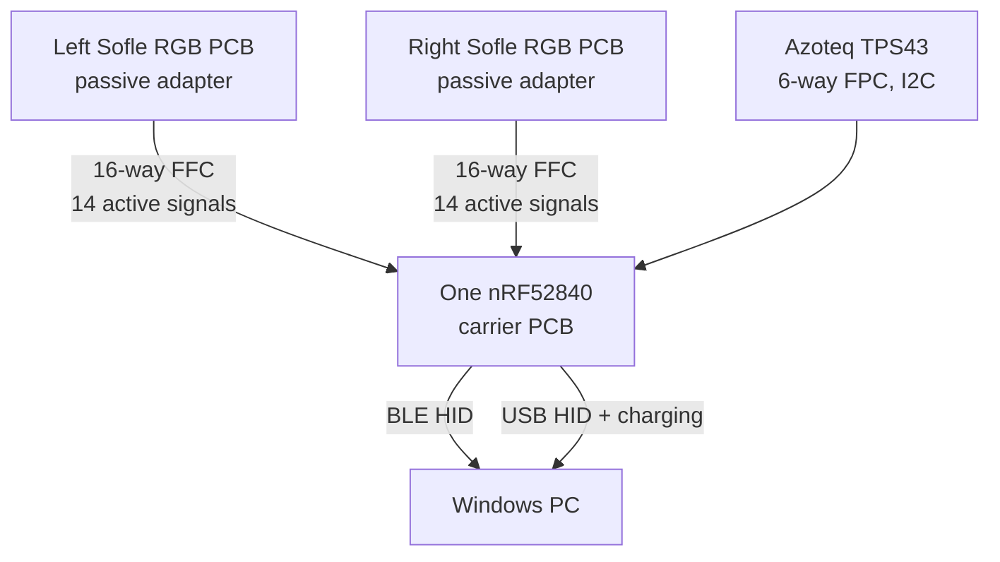
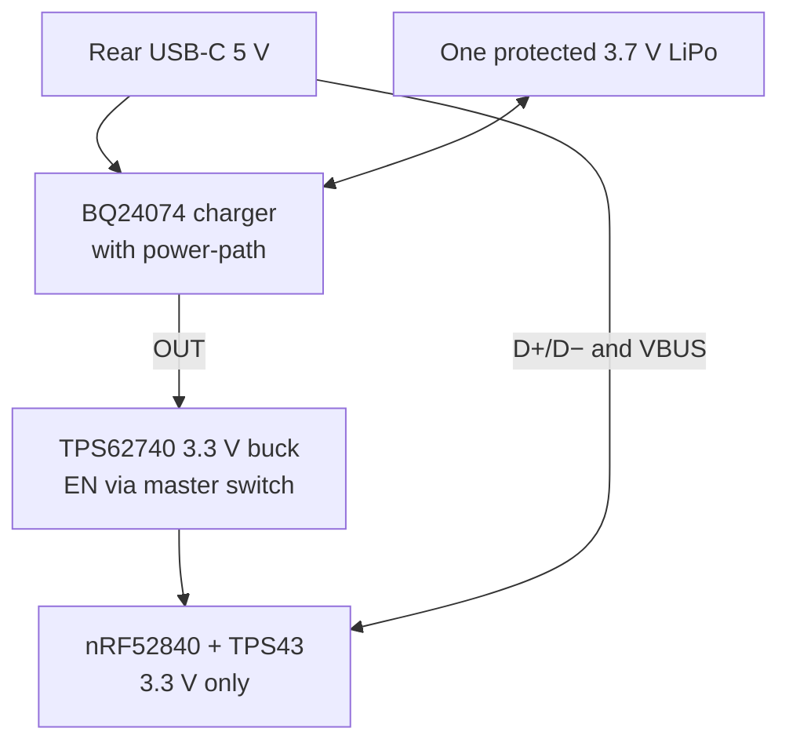

# Sofle RGB unibody — one-controller hardware design R3

Status: **source-verified architecture, preliminary electrical and mechanical design**.
This is not a fabrication-ready schematic or a tested charging circuit.

## Decisions

- Keep both existing Josef Adamcik Sofle RGB PCB halves. Replace both ATmega32U4 Pro Micros with **passive socket adapters**.
- Use **one** Raytac MDBT50Q-1MV2 (Nordic nRF52840) on a new carrier PCB. This is the only keyboard microcontroller.
- Join both halves with internal **wired FFC cables**. There is no Bluetooth link between halves.
- Use one protected 1-cell 3.7 V LiPo. Charge it through a single rear USB-C port.
- Use the **Azoteq TPS43-201A-S** (43 × 40 mm, IQS572, I2C) trackpad. It replaces the Cirque TM040040. See `ELECTRICAL_REVIEW.md` for the reasons and open risks.
- Use USB HID while USB is connected, and BLE HID while operating from the battery. One **ZMK** firmware image scans both halves and the trackpad. QMK does not support nRF52840 BLE.
- Leave the existing RGB LEDs and OLEDs disconnected in the low-power first build. The LEDs remain physically in the PCB. They do not receive power.

## Verified source PCB

Source: `reference/Sofle_RGB/PCB/SofleKeyboard.kicad_pcb`, Josef Adamcik commit `fb294f7c58d0f91c379a9ef339159d4d056643e9`.

`verify_matrix.py` reads each actual footprint pad and net. It confirmed:

| Existing U1 Pro Micro pads, **each half** | Net | Quantity |
|---|---|---:|
| 8–12 | `row0`–`row4` | 5 |
| 18–14 | `col0`–`col4` | 5 |
| 13 | `SW25A` (sixth column) | 1 |
| 20, 19 | `ENCA`, `ENCB` | 2 |
| 23 | GND | 1 |
| 1, 2, 5, 6, 21 | LED, interhalf DATA, I2C, VCC | **Disconnected in R3** |

Each half has 30 diode-protected switch positions: 29 normal switches and the encoder push switch (`SW25`). The pair has **60 positions and two encoder rotations**.

The source schematic defines diode pin 1 as cathode and pin 2 as anode. Diode pin 1 connects to `row*`. The firmware therefore scans **12 column outputs** and **five shared row inputs**. It must use the tested diode direction and correct row pull mode. It must not drive both halves through the old TRRS network.

## Signal architecture

The carrier PCB connects `row0`–`row4` from both halves together, then to five MCU inputs. It gives each half six separate column outputs. The encoder A/B pins remain independent. GND is common.

### U1 adapter: exact 16-pin FFC circuit (same logical mapping for each half)

| FFC pin | PCB U1 pad | PCB net | Operation |
|---:|---:|---|---|
| 1 | 8 | `row0` | Shared input |
| 2 | 9 | `row1` | Shared input |
| 3 | 10 | `row2` | Shared input |
| 4 | 11 | `row3` | Shared input |
| 5 | 12 | `row4` | Shared input |
| 6 | 18 | `col0` | Separate per half |
| 7 | 17 | `col1` | Separate per half |
| 8 | 16 | `col2` | Separate per half |
| 9 | 15 | `col3` | Separate per half |
| 10 | 14 | `col4` | Separate per half |
| 11 | 13 | `SW25A` | Separate sixth column |
| 12 | 20 | `ENCA` | Separate per half |
| 13 | 19 | `ENCB` | Separate per half |
| 14 | 23 | GND | Common |
| 15 | — | Not connected | Reserve |
| 16 | — | Not connected | Reserve |

Make the left and right adapters **different footprints if required for clearance**. Do not assume the flat cable is mirrored correctly. Confirm FFC pin 1 at both ends with a continuity meter.

### Preliminary nRF52840 module GPIO allocation

The pad numbers below come from the **Raytac MDBT50Q-1MV2 Version L 61-pad sheet**. There are no duplicate GPIO assignments.

| Function | MCU GPIO | Module pad |
|---|---|---|
| `ROW0..4` inputs | P0.13, P0.14, P0.15, P0.16, P0.17 | 37, 36, 39, 38, 41 |
| `RIGHT_COL0..5` outputs | P0.19, P0.20, P0.21, P0.22, P0.23, P0.24 | 42, 44, 43, 46, 45, 48 |
| `LEFT_COL0..5` outputs | P0.25, P0.26, P0.27, P1.00, P1.01, P1.02 | 49, 19, 16, 47, 61, 50 |
| Left encoder A/B | P1.03, P1.04 | 60, 56 |
| Right encoder A/B | P1.05, P1.06 | 59, 57 |
| TPS43 `SDA`, `SCL`, `RDY`, `NRST` | P0.04, P0.05, P0.06, P0.07 | 20, 21, 22, 23 |
| Spare (unrestricted) | P0.08 | 24 |
| Battery voltage sense | P0.02 / AIN0 | 11 |
| USB D−/D+ | nRF dedicated USB | 34, 35 |
| USB VBUS sense | VBUS | 32 |
| SWD programming | SWDIO, SWDCLK | 51, 53 |
| Hardware reset | P0.18 / nRESET | 40 |

**RF restriction:** The Raytac data sheet limits some P1.x and P0.0x pins to **low-frequency standard-drive I/O**. The allocated P1.x pins only handle key and encoder inputs/outputs, not I2C or RGB timing. The I2C pins above are general-purpose unrestricted pads (400 kHz is not low-frequency I/O). Keep key scanning below 10 kHz on any restricted pad. Preserve the antenna keep-out across every PCB layer.

### Azoteq TPS43-201A-S host connection

The Azoteq datasheet (v1.06, August 2025) gives the same 6-pin J1 pinout for TPS43 and TPS65.

| TPS43 J1 pin | Signal | Carrier connection |
|---:|---|---|
| 1 | `RDY` | nRF P0.06 (input) |
| 2 | `NRST` | nRF P0.07 (output) |
| 3 | GND | Common GND |
| 4 | `VDDHI` | Regulated +3.3 V. Absolute maximum is 3.6 V. |
| 5 | `SCL` | nRF P0.05, 4.7 kΩ pull-up to +3.3 V |
| 6 | `SDA` | nRF P0.04, 4.7 kΩ pull-up to +3.3 V |

- Supply range is 1.65–3.6 V. Tracking current is 2.23 mA typical. Low-power current is 23 µA typical.
- I2C runs up to 400 kHz. The ZMK driver uses address `0x74`.
- The datasheet does not state the pull-up value or the connector pitch. The 4.7 kΩ value is a standard choice, not a datasheet value.
- Order code `-201A-S` means hardware revision 2 (ZIF connector), standard gestures, adhesive-only overlay, single piece.
- Gestures: one-finger tap, press and hold, two-finger scroll, pinch and zoom. The datasheet does not list two-finger tap. The ZMK driver reports one.

## One-cell USB-C power path

The charger remains connected to the cell when the keyboard is OFF. Therefore, USB can charge the cell with the keyboard OFF. The slide switch controls the **regulator enable**, not the battery-positive wire. This avoids passing power through both old Pro Micro sockets.

The carrier PCB needs two 5.1 kΩ USB-C CC pull-downs, USB D+/D− ESD protection, charger current-limit parts, charger BAT/OUT capacitors, a 2.2 µH buck inductor, regulator capacitors, protected-cell connector, SWD test pads, and an NTC temperature sensor on the cell. Select resistor values from the final TI design calculations.

Do not connect the raw 4.2 V cell to the nRF VDD or TPS43 VDDHI. Do not connect charger 5 V to the Sofle VCC net. The carrier's 3.3 V supply stays isolated from the original LED VCC pins.

## Mechanical design

- The original source PCB geometry creates a continuous 390.0 × 135.85 mm top shell.
- **CAD is not updated for the TPS43.** `SofleRGB_SingleController_Cirque.scad` still models a 40.6 mm round opening and a 5.15 mm stack. Redo both for a 43 × 40 mm rectangle and a stack of about 1–3 mm (overlay dependent). The superseded `sofle_unibody_v2` model already has a rectangular pocket and retainer for this size.
- The one cell sits in the right front bay. The revised free envelope is **54 × 38 × 8 mm**, based on a nominal NOVA 603450 6 × 34 × 50 mm cell. Confirm its actual protection-board dimensions.
- The rear right bay reserves a **54 × 20 mm** *concept envelope* for the nRF carrier. The radio antenna faces the rear nonmetallic wall.
- The rear openings include one USB-C aperture, one switch aperture, and a small reset access hole. The USB-C connector mounts to the carrier PCB; there is no unverified panel extension or extra USB port.
- The upper shell is one continuous printed piece. The bottom service panel and trackpad retainer are separate removable parts.

## Engineering gates before any PCB order

1. Measure the actual TPS43 outline, FPC connector pitch, FPC exit direction, and overlay stack.
2. Verify actual left/right Pro Micro orientation, socket removal, adapter clearance, and FFC cable reach.
3. Determine the battery's protection-circuit dimensions, charge limit, connector, and polarity.
4. Finish the BQ24074 design, including thermistor-network calculations, USB current limit, and thermal simulation.
5. Finish the TPS62740 output voltage selection, feedback capacitors, and current budget.
6. Draw and review the carrier/adapter KiCad schematics and PCB footprints. Run ERC/DRC.
7. Check the Raytac antenna keep-out and the USB-C connector datum against the actual rear opening.
8. Flash firmware through SWD, then verify both complete 30-key matrices, both encoders, TPS43 I2C gestures, USB HID, BLE HID, and charging.
9. Print a small USB-C/switch/trackpad test piece before the large shell.

### Primary sources

- Original project: https://github.com/josefadamcik/SofleKeyboard
- Raytac module and 61-pad specification: https://www.raytac.com/product/ins.php?index_id=24
- Azoteq TPS43/TPS65 module datasheet v1.06: https://www.mouser.lt/datasheet/3/931/1/proxsense_i2c_trackpad_datasheet.pdf
- ZMK IQS5xx driver: https://github.com/AYM1607/zmk-driver-azoteq-iqs5xx
- TI charger: https://www.ti.com/product/BQ24074
- TI buck: https://www.ti.com/product/TPS62740

