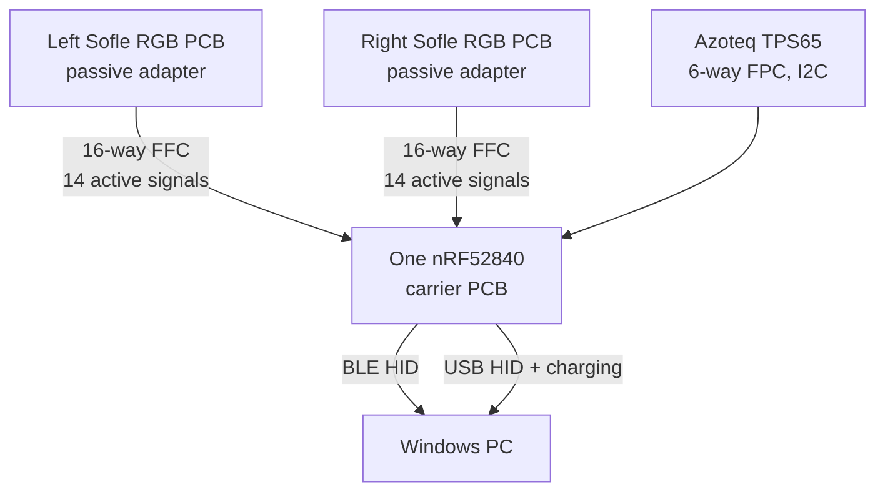
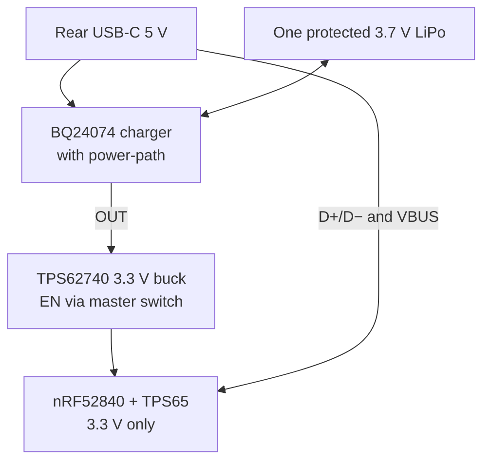

# Sofle RGB unibody — one-controller hardware design R3

Status: **source-verified architecture, preliminary electrical and mechanical design**.
This is not a fabrication-ready schematic or a tested charging circuit.

## Decisions

- Keep both existing Josef Adamcik Sofle RGB PCB halves. Replace both ATmega32U4 Pro Micros with **passive socket adapters**.
- Use **one** Raytac MDBT50Q-1MV2 (Nordic nRF52840) on a new carrier PCB. This is the only keyboard microcontroller.
- Join both halves with internal **wired FFC cables**. There is no Bluetooth link between halves.
- Use one protected 1-cell 3.7 V LiPo. Charge it through a single rear USB-C port.
- Use the **Azoteq TPS65-201A-S** (65 × 49 mm, IQS550, I2C) trackpad. It replaces the Cirque TM040040. See `ELECTRICAL_REVIEW.md` for the reasons and open risks.
- Use USB HID while USB is connected, and BLE HID while operating from the battery. One **ZMK** firmware image scans both halves and the trackpad. QMK does not support nRF52840 BLE.
- Leave the existing RGB LEDs and OLEDs disconnected. One 2.0 in screen replaces them. The LEDs remain physically in the PCB. They do not receive power.

## Verified source PCB

Source: `reference/Sofle_RGB/PCB/SofleKeyboard.kicad_pcb`, Josef Adamcik commit `fb294f7c58d0f91c379a9ef339159d4d056643e9`.

`verify_matrix.py` reads each actual footprint pad and net. It confirmed:

| Existing U1 Pro Micro pads, **each half** | Net | Quantity |
|---|---|---:|
| 8–12 | `row0`–`row4` | 5 |
| 18–14 | `col0`–`col4` | 5 |
| 13 | `SW25A` (sixth column) | 1 |
| 20, 19 | `ENCA`, `ENCB` | 2 |
| 23 | GND | 1 |
| 1, 2, 5, 6, 21 | LED, interhalf DATA, I2C, VCC | **Disconnected in R3** |

Each half has 30 diode-protected switch positions: 29 normal switches and the encoder push switch (`SW25`). The pair has **60 positions and two encoder rotations**.

The source schematic defines diode pin 1 as cathode and pin 2 as anode. Diode pin 1 connects to `row*`. The firmware therefore scans **12 column outputs** and **five shared row inputs**. It must use the tested diode direction and correct row pull mode. It must not drive both halves through the old TRRS network.

## Signal architecture

The carrier PCB connects `row0`–`row4` from both halves together, then to five MCU inputs. It gives each half six separate column outputs. The encoder A/B pins remain independent. GND is common.

### U1 adapter: exact 16-pin FFC circuit (same logical mapping for each half)

| FFC pin | PCB U1 pad | PCB net | Operation |
|---:|---:|---|---|
| 1 | 8 | `row0` | Shared input |
| 2 | 9 | `row1` | Shared input |
| 3 | 10 | `row2` | Shared input |
| 4 | 11 | `row3` | Shared input |
| 5 | 12 | `row4` | Shared input |
| 6 | 18 | `col0` | Separate per half |
| 7 | 17 | `col1` | Separate per half |
| 8 | 16 | `col2` | Separate per half |
| 9 | 15 | `col3` | Separate per half |
| 10 | 14 | `col4` | Separate per half |
| 11 | 13 | `SW25A` | Separate sixth column |
| 12 | 20 | `ENCA` | Separate per half |
| 13 | 19 | `ENCB` | Separate per half |
| 14 | 23 | GND | Common |
| 15 | — | Not connected | Reserve |
| 16 | — | Not connected | Reserve |

Make the left and right adapters **different footprints if required for clearance**. Do not assume the flat cable is mirrored correctly. Confirm FFC pin 1 at both ends with a continuity meter.

### Preliminary nRF52840 module GPIO allocation

The pad numbers below come from the **Raytac MDBT50Q-1MV2 Version L 61-pad sheet**. There are no duplicate GPIO assignments.

| Function | MCU GPIO | Module pad |
|---|---|---|
| `ROW0..4` inputs | P0.13, P0.14, P0.15, P0.16, P0.17 | 37, 36, 39, 38, 41 |
| `RIGHT_COL0..5` outputs | P0.19, P0.20, P0.21, P0.22, P0.23, P0.24 | 42, 44, 43, 46, 45, 48 |
| `LEFT_COL0..5` outputs | P0.25, P0.26, P0.27, P1.00, P1.01, P1.02 | 49, 19, 16, 47, 61, 50 |
| Left encoder A/B | P1.03, P1.04 | 60, 56 |
| Right encoder A/B | P1.05, P1.06 | 59, 57 |
| TPS65 `SDA`, `SCL`, `RDY`, `NRST` | P0.04, P0.05, P0.06, P0.07 | 20, 21, 22, 23 |
| Spare (unrestricted) | P0.08 | 24 |
| Battery voltage sense | P0.02 / AIN0 | 11 |
| USB D−/D+ | nRF dedicated USB | 34, 35 |
| USB VBUS sense | VBUS | 32 |
| SWD programming | SWDIO, SWDCLK | 51, 53 |
| Hardware reset | P0.18 / nRESET | 40 |

**RF restriction:** The Raytac data sheet limits some P1.x and P0.0x pins to **low-frequency standard-drive I/O**. The allocated P1.x pins only handle key and encoder inputs/outputs, not I2C or RGB timing. The I2C pins above are general-purpose unrestricted pads (400 kHz is not low-frequency I/O). Keep key scanning below 10 kHz on any restricted pad. Preserve the antenna keep-out across every PCB layer.

### Azoteq TPS65-201A-S host connection

The Azoteq datasheet (v1.06, August 2025) gives the same 6-pin J1 pinout for TPS65 and TPS65.

| TPS65 J1 pin | Signal | Carrier connection |
|---:|---|---|
| 1 | `RDY` | nRF P0.06 (input) |
| 2 | `NRST` | nRF P0.07 (output) |
| 3 | GND | Common GND |
| 4 | `VDDHI` | Regulated +3.3 V. Absolute maximum is 3.6 V. |
| 5 | `SCL` | nRF P0.05, 4.7 kΩ pull-up to +3.3 V |
| 6 | `SDA` | nRF P0.04, 4.7 kΩ pull-up to +3.3 V |

- Supply range is 1.65–3.6 V. Tracking current is 2.23 mA typical. Low-power current is 23 µA typical.
- I2C runs up to 400 kHz. The ZMK driver uses address `0x74`.
- The datasheet does not state the pull-up value or the connector pitch. The 4.7 kΩ value is a standard choice, not a datasheet value.
- Order code `-201A-S` means hardware revision 2 (ZIF connector), standard gestures, adhesive-only overlay, single piece.
- Gestures: one-finger tap, press and hold, two-finger scroll, pinch and zoom. The datasheet does not list two-finger tap. The ZMK driver reports one.

## One-cell USB-C power path

The charger remains connected to the cell when the keyboard is OFF. Therefore, USB can charge the cell with the keyboard OFF. The slide switch controls the **regulator enable**, not the battery-positive wire. This avoids passing power through both old Pro Micro sockets.

The carrier PCB needs two 5.1 kΩ USB-C CC pull-downs, USB D+/D− ESD protection, charger current-limit parts, charger BAT/OUT capacitors, a 2.2 µH buck inductor, regulator capacitors, protected-cell connector, SWD test pads, and an NTC temperature sensor on the cell. Select resistor values from the final TI design calculations.

Do not connect the raw 4.2 V cell to the nRF VDD or TPS65 VDDHI. Do not connect charger 5 V to the Sofle VCC net. The carrier's 3.3 V supply stays isolated from the original LED VCC pins.

## Mechanical design

Current CAD: `cad/r3/Sofpad_R3_Alice.scad`. Run `python cad/r3/check_design.py` after every change.

- Each Sofle half is tilted 12° toward the user (Alice-style), flat on the table. The case is 383 × 153 × 17.1 mm. A hinged tenting lift is deferred.
- Switches are Cherry MX style in the PCB's hot-swap sockets, so switches change without soldering. The plate is 1.5 mm and the PCB-to-plate distance is 5.0 mm, as the MX clips need. Keycaps in the renders are DSA-like, 7.4 mm tall.
- The TPS65 sits in the **centre, between the thumb clusters**, so either thumb reaches it. Its retainer is 73 × 57 mm.
- Behind the pad: the single 2.0 in screen sits in the shell skin (window 31.6 × 41.8 mm). Below it: the battery lying across (52 × 36 × 8 mm envelope for the NOVA 603450), then the carrier PCB (46 × 22 mm envelope) against the rear wall with USB-C and the slide switch.
- Battery and carrier mount on the removable service plate. Lifting the plate exposes both. The PCB halves stay in the shell. The checks prove 1.1 mm between the screen module and the battery.

## Screen, connectivity and added hardware (R3 decisions, 10 Nov 2026)

- **One large screen replaces both OLEDs.** 2.0 in 240 × 320 IPS, ST7789, SPI, portrait, centre rear. Backlit, so it reads in a dark living room. The backlight dims, then the screen sleeps on a timeout. This removes the second I2C bus and the 18-way FFC idea, so the harness stays 16-way.
- **Proposed screen pins** (confirm against the Raytac pad sheet when drawing the schematic): SCK P0.31, MOSI P0.30, CS P0.29, DC P0.28, RST P1.09, backlight PWM P1.10. Accelerometer interrupt on the spare P0.08.
- **USB cable or Bluetooth:** both are always available. ZMK selects the output (`OUT_USB`, `OUT_BLE`, toggle) and holds 5 Bluetooth profiles. Plugging in USB-C also charges.
- **Haptic click:** DRV2605L plus a 10 mm LRA under the trackpad retainer (I2C 0x5A, shared with the TPS65 at 0x74).
- **Accelerometer:** LIS3DH (I2C 0x18) wakes the keyboard when lifted and lets it sleep when left still.

## Firmware and software plan

| Layer | Plan |
|---|---|
| Keyboard firmware | ZMK (Zephyr) on the nRF52840 with a custom board `sofpad_r3`. 12 column outputs, 5 row inputs with pull-downs, `diode-direction = "col2row"`. Two EC11 encoders. |
| Trackpad | `AYM1607/zmk-driver-azoteq-iqs5xx` on I2C 0x74. It is tested on TPS43 and TPS65. Add tap, scroll and two-finger gestures through ZMK input processors. |
| Haptics, motion | Small ZMK module: DRV2605L effects on tap and click. Zephyr `st,lis2dh` driver, interrupt wakes from idle (not soft-off; see the power section). |
| Screen | Zephyr ST7789 display driver and LVGL. Screens that need no PC: layer and mode, battery, USB or Bluetooth state, uptime. With the optional app: clock, media, PC stats. |
| PC link (optional) | USB raw HID: a custom report can carry extra data to the screen. The keyboard, trackpad and screen work with no PC software at all. |
| PC app (optional, later) | `sofpad-host`: a small tray app for extra screen data (clock sync, CPU, volume, now playing). Never required. |
| PC link over Bluetooth | Custom GATT service for the same display data. Deferred. |
| Build | Local `west` build, then GitLab CI on the self-hosted runners. GitHub Actions is not allowed. Firmware lives in `firmware/` when started. |
| Updates | USB DFU first. Over-the-air later. |

## Power and sleep/wake design (decided 10 Nov 2026)

Goal: months of standby, and no lag on the first key, touch or encoder click after any idle time.

**Decision: never use soft-off (System OFF) for idle.** System OFF resets the MCU, so wake means a reboot plus a Bluetooth reconnect (about a second of lag). The firmware stays in System ON low-power idle with RAM retained (a few µA) and wakes from GPIO events in microseconds. Soft-off is only for the master switch and low-battery cutoff. At about 10 µA the 1100 mAh cell would last years, so the few µA cost buys zero wake lag. Set `CONFIG_ZMK_SLEEP=n` and use ZMK idle plus Zephyr device power management (`CONFIG_PM_DEVICE=y`).

| Source | Idle design | Wake path |
|---|---|---|
| Key matrix | All 12 columns driven high, 5 row inputs with internal pull-downs. No current flows until a key closes. ZMK interrupt-driven `zmk,kscan-gpio-matrix` with `wakeup-source`. No polling timer while idle. | Row edge (GPIOTE PORT) |
| Encoders | Contacts to GND can sit closed. Use **470 kΩ external pull-ups** with the internal pulls off (7 µA worst per closed line, against 250 µA for the 13 kΩ internal pull-up). Edges stay clean at 470 kΩ. | A/B edge (PORT) |
| Trackpad | Powered always (23 µA typical in low-power mode). Set the IQS550 low-power report periods so the first touch is reported in 50 ms or less. | RDY line (P0.06) |
| Accelerometer | LIS3DH in low-power mode at 10 Hz with the wake-on-motion interrupt. Single-digit µA. It wakes the keyboard when it is lifted or touched, **before the hand reaches the keys**, so the Bluetooth link is already up. | INT (P0.08) |
| Haptics | DRV2605L in standby. Power it up only on a click. | none |
| Screen | ST7789 in Sleep-In. Backlight FET gate has a pull-down so it is off at reset. Backlight at 10 % or lower while awake, off after 10 s without input. The backlight (tens of mA) is the largest load, so it is the main budget item. | wake event turns it on |
| Regulator | TPS62740 (0.36 µA quiescent), enabled by the master switch. Peripherals share its 3.3 V rail with no per-part load switches. | switch |
| Bluetooth | Stay connected while idle with a long connection interval and peripheral latency. Latency adds no lag to keyboard-to-host data, because the keyboard sends at the next event whenever it has data. After 15 min idle drop to slow directed advertising. A reconnect (up to about a second) is hidden by the accelerometer pre-wake. | accelerometer, key |
| USB | When VBUS is present, no idle timeouts and no radio sleep. Handle USB suspend so the PC can sleep and wake the keyboard. | VBUS |

**Budget targets** (verify on the bench): connected idle at or below 60 µA average (about two years of standby); typing about 3 mA average; screen on adds the backlight current. The bench check uses a µA-capable current profiler and the ZMK Power Profiler as a cross-check.

**Acceptance tests (gate before the full shell):**
1. Key, encoder and trackpad each deliver the first event within 10 ms, 10 ms and 50 ms of waking from idle (measured with a logic analyser on the wake pin and the HID report).
2. Idle current at or below 60 µA with the screen asleep and Bluetooth connected; no step above 100 µA from any single part.
3. After 2 h idle, lifting the keyboard brings the link up before the first keypress.
4. With the switch OFF and USB present, the cell charges and the MCU draws nothing.
5. 100 sleep/wake cycles with no stuck key, missed key or lost Bluetooth pairing.

## Verification without hardware

All scripts are in `hardware/r3/pcb`. Run them after any design change; every one must pass before ordering.

| Check | Command | Proves |
|---|---|---|
| Schematic rules | `python erc.py carrier` | No floating pins, no pin conflicts |
| Placement gate | `python placecheck.py` (KiCad python) | Courtyards, board edge and pad spacing are clean before routing (seconds) |
| Layout rules | `python drc.py carrier carrier` | Spacing, width, drill and edge limits, no unconnected nets |
| Three-way netlist | `python compare_nets.py carrier carrier carrier` (KiCad python) | The generator, the schematic KiCad derives, and the routed PCB agree on every net |
| Signal paths | `python verify_paths.py` | Each Sofle key row, column and encoder pin reaches the intended nRF52840 GPIO through the adapter, cable and carrier (both halves) |
| Power values | `python power_check.py` | Charger, regulator, divider, I2C and load numbers against the datasheet formulas |
| Pin audit | `python pin_audit.py U2 U4 U5 U6 J1` | Every IC pin function and net, to compare with the datasheet |
| Case | `python ../../../cad/r3/check_design.py` | Fit, overlaps, single-piece shell and plate, closed meshes |

Findings that remain open (cannot be settled without a board): the nRF52840 with VBUS present and the switch off, the FFC contact type (buy A and D), the TPS65 flex pitch, the NTC must be plugged in for the BQ24074 to charge, the Waveshare backlight pin drive, and encoder pull-up drain (470 kOhm draws 7 uA per closed contact).

## Manufacturing (PCB order settings)

Files: `hardware/r3/pcb/fab_export.py <folder> <board>` writes Gerbers, drill, pick-and-place, a BOM grouped by value and a zip to `pcb/fab/`.

| Board | Layers | Thickness | Notes |
|---|---|---|---|
| Carrier | 4 (GND on In1/In2) | 1.0 mm | Black solder mask, ENIG, fab assembly of all SMD parts (top and bottom) |
| Adapter A and B | 2 | 1.6 mm | Black mask, ENIG. Solder straight into the Sofle U1 holes. B is the mirror of A |

- Order from JLCPCB with assembly and ship to India. Import duty and courier add cost, so compare against an Indian fab (for example PCBPower or Robu) on the day, but only if the Indian quote includes assembly.
- The fab places everything SMD, including the JST PH connectors, PCM12 switch and Hirose FFC sockets. Hand work left: plugging in the cables, battery and screen.
- FFC cables: both are 50 mm. Buy A-type and D-type contacts (contacts on the same or opposite side). One of them fits; the other is spare.
- Black mask and ENIG are cosmetic and match the "beautiful inside" rule. They do not change the design.

## Engineering gates before any PCB order

1. Measure the actual TPS65 outline, FPC connector pitch, FPC exit direction, and overlay stack.
2. Verify actual left/right Pro Micro orientation, socket removal, adapter clearance, and FFC cable reach.
3. Determine the battery's protection-circuit dimensions, charge limit, connector, and polarity.
4. Finish the BQ24074 design, including thermistor-network calculations, USB current limit, and thermal simulation.
5. Finish the TPS62740 output voltage selection, feedback capacitors, and current budget.
6. Draw and review the carrier/adapter KiCad schematics and PCB footprints. Run ERC/DRC.
7. Check the Raytac antenna keep-out and the USB-C connector datum against the actual rear opening.
8. Flash firmware through SWD, then verify both complete 30-key matrices, both encoders, TPS65 I2C gestures, USB HID, BLE HID, and charging.
9. Print a small USB-C/switch/trackpad test piece before the large shell.

### Primary sources

- Original project: https://github.com/josefadamcik/SofleKeyboard
- Raytac module and 61-pad specification: https://www.raytac.com/product/ins.php?index_id=24
- Azoteq TPS65/TPS65 module datasheet v1.06: https://www.mouser.lt/datasheet/3/931/1/proxsense_i2c_trackpad_datasheet.pdf
- ZMK IQS5xx driver: https://github.com/AYM1607/zmk-driver-azoteq-iqs5xx
- TI charger: https://www.ti.com/product/BQ24074
- TI buck: https://www.ti.com/product/TPS62740

